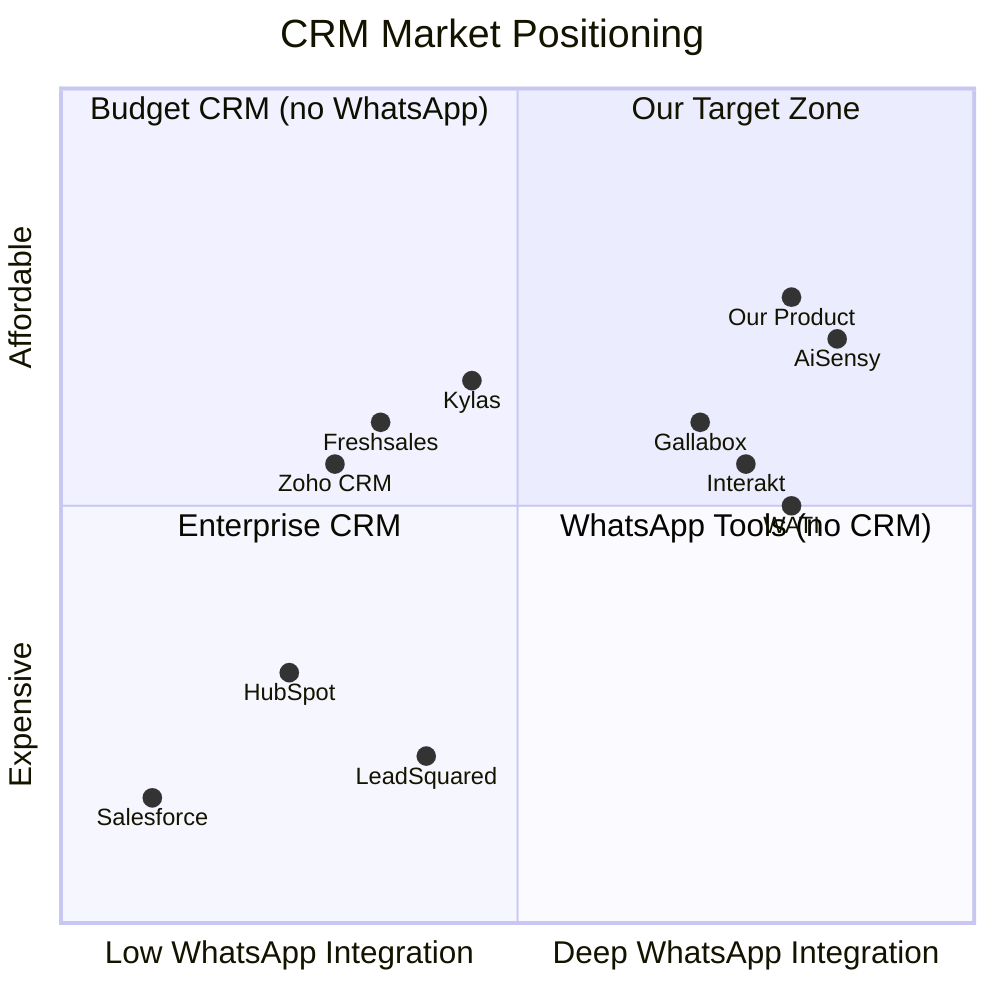

# Competitor Analysis — AI Sales CRM & Automation SaaS

## Market Landscape

Competitors 4 categories mein aate hain:



---

## Category 1: WhatsApp-First Platforms

Ye sirf WhatsApp communication karte hain — **full CRM nahi hai.**

| Competitor | Price | Strengths | Weakness |
|---|---|---|---|
| **WATI** | ₹2,499/mo | Shared inbox, chatbots, good UI | No CRM, no pipeline, no invoicing |
| **Interakt** | ₹2,499/mo | D2C/ecommerce focus, catalog | No sales pipeline, no AI |
| **AiSensy** | ₹999/mo | Cheap, broadcast, chatbot | No CRM at all, basic features |
| **Gallabox** | ₹1,499/mo | Shared inbox, multi-agent | No CRM, no deals, no automation |
| **Getgabs** | ₹1,299/mo | WhatsApp marketing focus | Very basic, no CRM depth |
| **Groweon** | ₹999/mo | Budget friendly | Limited features |

> [!IMPORTANT]
> **Inke paas CRM nahi hai.** Ye sirf WhatsApp messaging tools hain. Customer ko pipeline, deals, invoices, automation ke liye alag tool chahiye. **Yahi gap hai.**

---

## Category 2: Indian CRM Suites

Ye CRM hain — but **WhatsApp integration kamzor ya expensive hai.**

| Competitor | Price | Strengths | Weakness |
|---|---|---|---|
| **Kylas** | ₹12,999/mo (unlimited users) | Unlimited users, Indian focus, pipelines | **Expensive** for small teams, WhatsApp basic |
| **LeadSquared** | Custom (₹15,000+/mo) | Enterprise-grade, field sales, automation | **Very expensive**, complex setup, not for SMBs |
| **TatvaCRM** | ₹500+/user/mo | WhatsApp logging, India focus | Basic automation, no AI |
| **Freshsales** | $9-59/user/mo | Built-in phone, Freddy AI, easy UI | WhatsApp via third-party, no native inbox |
| **HelloGrowthCRM** | ₹899/user/mo | Flat pricing | Limited features, small company |

---

## Category 3: Global CRM Giants

India mein bhi use hote hain, but **SMBs ke liye overkill aur expensive.**

| Competitor | Price | Strengths | Weakness |
|---|---|---|---|
| **Salesforce** | $25+/user/mo | Market leader, everything possible | Too complex, too expensive, no WhatsApp native |
| **HubSpot** | Free–$800/mo | Great free tier, marketing | WhatsApp weak, expensive at scale, US-focused |
| **Zoho CRM** | ₹800+/user/mo | Feature-rich, Indian company | Complex setup, WhatsApp needs separate integration |
| **Pipedrive** | $14+/user/mo | Clean pipeline UI | No WhatsApp, no Indian payment, no Hindi support |

---

## Category 4: Enterprise BSPs (Developer-First)

Ye platforms hain, products nahi. Inke upar build karna padta hai.

| Provider | Role | Relevance |
|---|---|---|
| **Gupshup** | WhatsApp BSP | Potential integration partner, not competitor |
| **Twilio** | Communication APIs | Developer tool, not end-user product |
| **360dialog** | WhatsApp API access | Infrastructure provider |
| **Infobip** | Omnichannel messaging | Enterprise messaging |

> [!NOTE]
> Ye competitors nahi hain — ye **potential providers** hain jinke API ke through humara product WhatsApp access karega.

---

## Direct Competitor Comparison

Jo humse **directly compete** karenge:

| Feature | **Our Product** | WATI | Interakt | Kylas | Freshsales | Zoho |
|---|---|---|---|---|---|---|
| **Price** | ₹999–4,999/mo | ₹2,499/mo | ₹2,499/mo | ₹12,999/mo | $9-59/user | ₹800+/user |
| **CRM** | ✅ Full | ❌ | ❌ | ✅ Full | ✅ Full | ✅ Full |
| **WhatsApp Inbox** | ✅ Native | ✅ Native | ✅ Native | ⚠️ Basic | ❌ Third-party | ⚠️ Add-on |
| **Sales Pipeline** | ✅ | ❌ | ❌ | ✅ | ✅ | ✅ |
| **AI Assistant** | ✅ | ❌ | ❌ | ⚠️ Basic | ✅ Freddy | ⚠️ Zia |
| **Automation** | ✅ Visual builder | ⚠️ Basic | ⚠️ Basic | ✅ | ✅ | ✅ |
| **Invoicing** | ✅ | ❌ | ❌ | ❌ | ❌ | ✅ Separate |
| **Razorpay** | ✅ Native | ❌ | ⚠️ Limited | ❌ | ❌ | ❌ |
| **Multi-tenant** | ✅ | N/A | N/A | N/A | N/A | N/A |
| **Indian SMB Focus** | ✅ | ⚠️ | ✅ | ✅ | ❌ | ⚠️ |

---

## Market Gap — Humara Sweet Spot

```
                    CRM Depth
                       ↑
         Zoho ●        |        ● LeadSquared
                       |
    Freshsales ●       |    ● Kylas
                       |
                       |         ★ OUR PRODUCT
                       |
                       |    ● Gallabox
         AiSensy ●    |        ● WATI
                       |
          ─────────────┼──────────────→
                       |        WhatsApp Depth
```

> **Gap**: Koi bhi product ₹999–4,999/mo range mein **CRM + native WhatsApp + AI + automation + invoicing** sab ek saath nahi de raha Indian SMBs ko.

---

## Humara Competitive Advantage

| Advantage | Detail |
|---|---|
| 🎯 **All-in-one** | CRM + WhatsApp + AI + Automation + Invoicing — sab ek jagah |
| 💰 **Affordable** | ₹999/mo se start — WATI/Interakt se sasta, Kylas se 13x sasta |
| 🇮🇳 **India-first** | Razorpay, INR pricing, Indian business workflows |
| 🤖 **AI built-in** | Lead qualification, reply suggestions, conversation summaries |
| 📱 **WhatsApp native** | Inbox, templates, automation — first-class citizen |
| 🏢 **Multi-industry** | Ek product — Real estate, Education, Agency, B2B sab ke liye |

---

## Sabse Bade Risks

| Risk | Mitigation |
|---|---|
| WATI/Interakt CRM add kar dein | Humara CRM deeper hoga — pipeline, deals, invoicing, AI |
| Zoho/Freshsales WhatsApp improve karein | Unka pricing per-user hai, humaara flat plan hai |
| New startup same idea se aaye | First-mover + execution speed |
| Meta WhatsApp API policy change | Provider abstraction layer se switch kar sakte hain |
